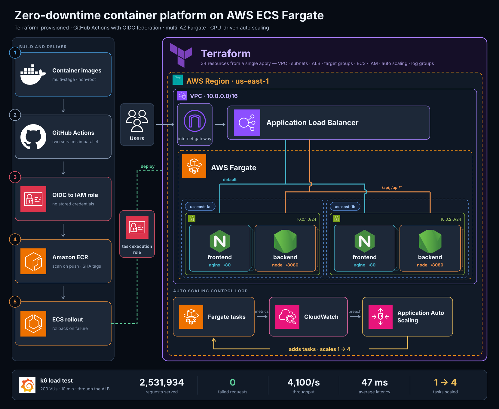
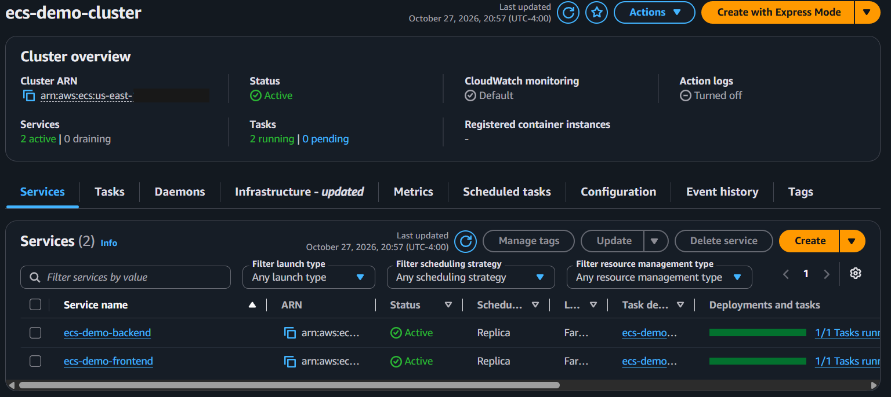
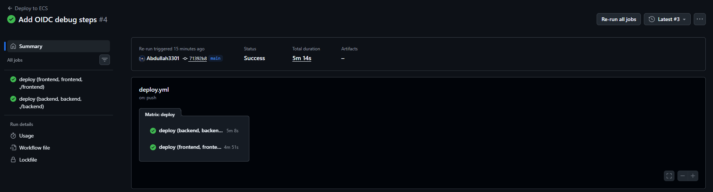
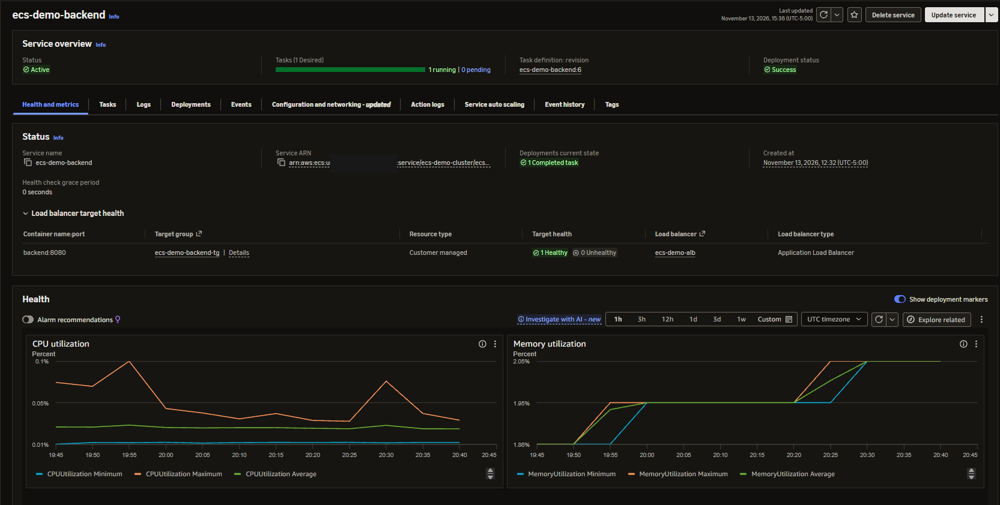
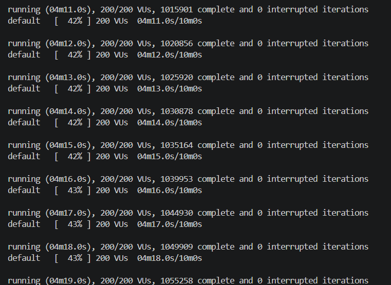
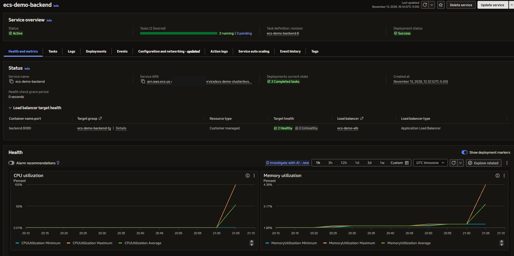
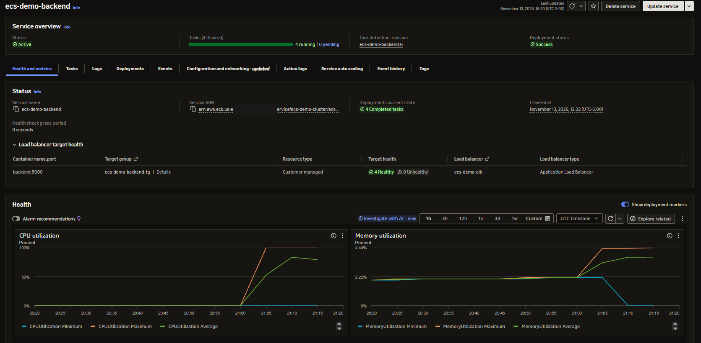
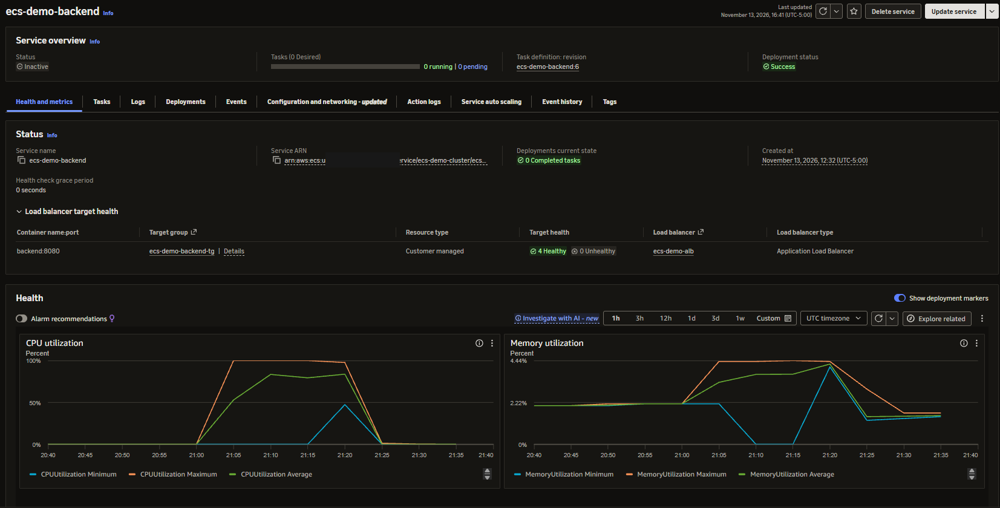

# Zero-Downtime Container Platform on AWS ECS Fargate

A two-service web application deployed to AWS Fargate behind an Application Load Balancer, with infrastructure defined entirely in Terraform and a GitHub Actions pipeline that authenticates to AWS using OIDC federation — no long-lived AWS credentials are stored anywhere.

The platform was load tested at **2,531,934 requests with zero failures** and verified to auto-scale from **1 to 4 tasks** under sustained load.



---

## Contents

- [What this demonstrates](#what-this-demonstrates)
- [Architecture](#architecture)
- [Infrastructure as code](#infrastructure-as-code)
- [CI/CD pipeline](#cicd-pipeline)
- [Running it locally](#running-it-locally)
- [Deploying](#deploying)
- [Load testing and auto scaling](#load-testing-and-auto-scaling)
- [Problems I hit](#problems-i-hit)
- [Security decisions](#security-decisions)
- [Cost](#cost)
- [What I would change for production](#what-i-would-change-for-production)
- [Repository layout](#repository-layout)

---

## What this demonstrates

| Area | What was built |
|---|---|
| Containerisation | Multi-stage Docker builds, non-root runtime user, `.dockerignore` |
| Infrastructure as code | 34 AWS resources from a single `terraform apply` |
| Networking | VPC, public subnets across two availability zones, path-based routing |
| CI/CD | Matrix build pipeline, OIDC federation, rolling deploys with automatic rollback |
| Security | Least-privilege IAM, security group chaining, no stored cloud credentials |
| Operations | CloudWatch logging and metrics, CPU-driven auto scaling, load testing |

The application itself is deliberately simple — a React frontend and an Express API. The engineering is in everything around it.


---

## Architecture

### The request path

1. A user resolves the load balancer's public DNS name.
2. The ALB listener on port 80 evaluates its rules.
3. Requests matching `/api` or `/api/*` go to the backend target group on port 8080.
4. Everything else falls through to the default action and hits the frontend target group on port 80.
5. Both target groups are type `ip`, which is required for Fargate's `awsvpc` networking mode — each task gets its own elastic network interface.

### Why one load balancer instead of two

The obvious design is a load balancer for the frontend and another for the API. That gives you two public hostnames, which means the browser treats the API as a different origin, which means CORS — preflight requests, `Access-Control-Allow-Origin` headers, and a configuration value that has to change for every environment.

Instead, both services sit behind **one** load balancer and are separated by path. The React app calls `/api/` as a relative path, so the browser never sees a second origin and never issues a preflight request.

To make local development behave identically, `docker-compose` runs an nginx reverse proxy in front of both containers that mirrors the same path routing. The same relative URLs work on `localhost` and in AWS with no code change and no environment-specific configuration.

### What runs where

| Service | Image | Port | Resources | Placement |
|---|---|---|---|---|
| frontend | `nginx:alpine` | 80 | 0.5 vCPU, 1 GB | Fargate, both AZs |
| backend | `node:22-alpine` | 8080 | 0.5 vCPU, 1 GB | Fargate, both AZs |



---

## Infrastructure as code

Everything inside the AWS boundary is Terraform-managed. A single `terraform apply` creates 34 resources:

| File | Resources |
|---|---|
| `network.tf` | VPC `10.0.0.0/16`, 2 public subnets in 2 AZs, internet gateway, route table and associations, 2 security groups |
| `alb.tf` | Application Load Balancer, 2 target groups, HTTP listener, path-based listener rule |
| `ecr.tf` | 2 private repositories with image scanning and a lifecycle policy retaining the last 5 images |
| `ecs.tf` | Cluster, 2 CloudWatch log groups, task execution role, 2 task definitions, 2 services with deployment circuit breaker |
| `autoscaling.tf` | 2 scalable targets, 2 target-tracking policies |
| `github-oidc.tf` | IAM OIDC identity provider, deploy role, least-privilege policy |

### Notable Terraform details

**Dynamic OIDC thumbprint.** The GitHub OIDC provider's certificate thumbprint is fetched at plan time rather than hardcoded:

```hcl
data "tls_certificate" "github" {
  url = "https://token.actions.githubusercontent.com"
}

resource "aws_iam_openid_connect_provider" "github" {
  url             = "https://token.actions.githubusercontent.com"
  client_id_list  = ["sts.amazonaws.com"]
  thumbprint_list = [for c in data.tls_certificate.github.certificates : c.sha1_fingerprint]
}
```

A hardcoded thumbprint is a time bomb — it breaks silently when GitHub rotates its certificate. See [Problems I hit](#problems-i-hit).

**Security group chaining.** The task security group does not reference a CIDR block. It accepts traffic only from the load balancer's security group:

```hcl
ingress {
  from_port       = 8080
  to_port         = 8080
  protocol        = "tcp"
  security_groups = [aws_security_group.alb.id]
}
```

Tasks run in public subnets with public IPs so they can reach ECR without a NAT gateway, but there is no network path to them from the internet. Only the load balancer can open a connection.

**Ignoring pipeline-driven drift.** The services declare:

```hcl
lifecycle {
  ignore_changes = [desired_count, task_definition]
}
```

The pipeline updates the task definition and auto scaling updates the desired count. Without this, the next `terraform apply` would revert both.

---

## CI/CD pipeline

Push to `main` touching `backend/`, `frontend/` or the workflow file triggers a deploy. The pipeline builds both services in parallel using a matrix strategy.

```
git push -> GitHub Actions -> OIDC token -> AWS STS -> temporary credentials
         -> build image -> push to ECR -> register task definition
         -> update ECS service -> wait for stability
```

### No stored AWS credentials

The pipeline holds no access keys. GitHub issues a short-lived signed JWT, AWS validates it against the OIDC identity provider, and STS returns credentials valid for approximately 15 minutes. The trust policy pins the subject claim to this repository and the `main` branch, so no other repository or branch can assume the role.

```yaml
permissions:
  id-token: write
  contents: read
```

The deploy role's permissions are scoped to the two ECR repositories and the two ECS services. `iam:PassRole` is conditioned on `iam:PassedToService = ecs-tasks.amazonaws.com`, so the role cannot pass arbitrary IAM roles to arbitrary services.

### Zero-downtime deploys

Deployments are rolling — new tasks start and pass health checks before old ones drain. The ECS deployment circuit breaker is enabled, so a failed rollout rolls back automatically rather than leaving the service degraded. The pipeline uses `wait-for-service-stability: true`, so a green build means the new revision is actually serving traffic.

Images are tagged with the commit SHA, so every running task traces back to an exact commit.



---

## Running it locally

Requires Docker and Docker Compose.

```bash
git clone https://github.com/Abdullah3301/ecs-fargate-terraform-github-actions.git
cd ecs-fargate-terraform-github-actions
docker compose up --build
```

Then open <http://localhost:8000>.

The compose stack runs three containers: the frontend, the backend, and an nginx proxy that reproduces the load balancer's path routing. Requests to `/api/` reach the backend; everything else reaches the frontend — exactly as in AWS.

---

## Deploying

### Prerequisites

- Terraform 1.5 or later
- AWS CLI configured with credentials that can create the resources listed above
- Docker

### First apply

ECR repositories must exist before images can be pushed, and ECS services need an image to start from. So the first apply is staged:

```bash
cd terraform
terraform init

# 1. Create the registries first
terraform apply -target=aws_ecr_repository.app

# 2. Build and push an initial image for each service
aws ecr get-login-password --region us-east-1 \
  | docker login --username AWS --password-stdin <ACCOUNT_ID>.dkr.ecr.us-east-1.amazonaws.com

docker build -t <ACCOUNT_ID>.dkr.ecr.us-east-1.amazonaws.com/ecs-demo-frontend:initial ../frontend
docker push <ACCOUNT_ID>.dkr.ecr.us-east-1.amazonaws.com/ecs-demo-frontend:initial

docker build -t <ACCOUNT_ID>.dkr.ecr.us-east-1.amazonaws.com/ecs-demo-backend:initial ../backend
docker push <ACCOUNT_ID>.dkr.ecr.us-east-1.amazonaws.com/ecs-demo-backend:initial

# 3. Create everything else
terraform apply
```

`terraform output app_url` prints the load balancer address.

### Wiring up the pipeline

`terraform output github_actions_role_arn` prints the role the pipeline assumes. Add it as a repository secret named `AWS_ROLE_ARN` under **Settings -> Secrets and variables -> Actions**.

It is stored as a secret rather than a variable deliberately: GitHub masks secrets in workflow logs, variables are printed in plain text, and the ARN contains the AWS account ID.

### Tearing down

```bash
terraform destroy
```

ECR repositories are declared with `force_delete = true`, so they are removed along with any images still in them.

---

## Load testing and auto scaling

Auto scaling uses target tracking against `ECSServiceAverageCPUUtilization` with a target of 50%, a minimum of 1 task and a maximum of 4. Scale-out cooldown is 60 seconds, scale-in is 120 seconds — deliberately asymmetric, so the service adds capacity quickly and gives it up slowly.

### Test setup

[k6](https://k6.io) driving traffic through the load balancer at the API path:

```javascript
import http from 'k6/http';

export const options = { vus: 200, duration: '10m' };

export default function () {
  http.get(`${__ENV.ALB_URL}/api/`);
}
```

```bash
k6 run -e ALB_URL=http://<your-alb-dns-name> loadtest.js
```

### Results

| Metric | Result |
|---|---|
| Requests served | 2,531,934 |
| Failed requests | 0 (0.00%) |
| Sustained throughput | ~4,100 requests/second |
| Average latency | 47 ms |
| 95th percentile latency | 75 ms |
| Tasks before load | 1 |
| Tasks at peak | 4 |

### Scaling behaviour

Baseline before the test — a single task per service:



Load test running:



CPU crosses the 50% target and the service scales out:



Peak capacity reached:



After the test ends, the service scales back in to the minimum:



---

## Problems I hit

Documenting these because the debugging was the most useful part of the project.

### 1. OIDC token could not be validated

The pipeline failed at the credential step:

```
Error: Could not assume role with OIDC:
The web identity token provided could not be validated.
```

The trust policy and the audience were both correct. The clue was in the specific wording — AWS returns a *different* error when claims do not match a trust condition. "Could not be validated" means the token's signature could not be verified, which pointed at the identity provider's certificate thumbprint rather than the policy.

The thumbprint had been hardcoded from a documentation example and GitHub had since rotated its certificate. Fixed by deriving it from a `tls_certificate` data source so it is always current at plan time.

### 2. Not authorized to perform sts:AssumeRoleWithWebIdentity

The next failure looked like a simple mismatch, except the expected and actual subject claims appeared identical when printed side by side.

They were not. GitHub was issuing a token using **immutable subject claims**, which append numeric owner and repository IDs:

```
expected: repo:your-org/your-repo:ref:refs/heads/main
actual:   repo:your-org@<OWNER_ID>/your-repo@<REPO_ID>:ref:refs/heads/main
```

The difference is invisible unless you decode the token. The fix was adding a step to the workflow that fetched the OIDC token and printed its claims:

```yaml
- name: Decode the OIDC token
  run: |
    TOKEN=$(curl -sH "Authorization: bearer $ACTIONS_ID_TOKEN_REQUEST_TOKEN" \
      "$ACTIONS_ID_TOKEN_REQUEST_URL&audience=sts.amazonaws.com" | jq -r '.value')
    echo "$TOKEN" | cut -d. -f2 | base64 -d | jq '{sub, aud, iss, repository}'
```

Thirty seconds of output ended two hours of guessing. **The step is not in this repository** — it decodes a live credential, and workflow logs on a public repository are public. It was removed once the pipeline worked.

### 3. ecs:TagResource access denied

With authentication working, the deploy failed registering a task definition. The least-privilege policy granted `ecs:RegisterTaskDefinition` but not `ecs:TagResource`.

The cause was the Terraform provider's `default_tags` block. Every resource it creates carries project tags, including task definitions registered by the pipeline — so registering one is also a tagging operation. One missing action in the policy.

### 4. The load test measured the wrong service

The first run reported 2.5 million requests, zero failures, and a backend sitting at 0.03% CPU. Impressive numbers and completely meaningless.

The k6 script was requesting `/` rather than `/api/`. Every request had hit the frontend's default action — nginx serving a static file — and never reached the backend at all. The path routing was working perfectly, which is exactly why the test proved nothing.

Appending `/api/` produced the real result, and the backend scaled as designed.

---

## Security decisions

| Decision | Rationale |
|---|---|
| OIDC federation instead of access keys | Nothing long-lived to leak, rotate, or accidentally commit |
| Trust policy pinned to repository and branch | Another repository cannot assume the deploy role |
| `iam:PassRole` conditioned on `PassedToService` | The pipeline cannot pass arbitrary roles to arbitrary services |
| Task security group accepts only the ALB security group | No network path to tasks from the internet |
| Non-root container user | A compromised process does not get root inside the container |
| Image scanning on push | Known CVEs surface at build time |
| Image tags are commit SHAs | Every running task traces to an exact commit |
| Deploy role scoped to named repositories and services | Blast radius limited to this application |

---

## Cost

Roughly **$0.09 per hour** with everything running — two Fargate tasks at 0.5 vCPU and 1 GB, one Application Load Balancer, and minimal data transfer.

The largest cost decision was **not provisioning a NAT gateway**. Tasks run in public subnets with public IPs assigned, which lets them pull images from ECR directly. A NAT gateway would cost more than the rest of the stack combined and buys nothing here, because the security group already denies all inbound traffic that does not originate from the load balancer.

CloudWatch log retention is set to 7 days rather than the default of never expiring.

The environment is destroyed when not in use. Total cost of building and validating this project was under $1.

---

## What I would change for production

This is a portfolio build, not a production system. The gaps are deliberate and worth naming.

- **HTTPS.** The listener is HTTP on port 80. Production needs an ACM certificate, a 443 listener, and a redirect from 80.
- **Private subnets.** Tasks should sit in private subnets with either a NAT gateway or VPC endpoints for ECR, CloudWatch and S3. The current design is safe but relies entirely on the security group.
- **Remote Terraform state.** State is local. A team needs S3 with DynamoDB state locking.
- **Scale on the right signal.** CPU is a proxy. Request count per target or ALB response time usually tracks user experience better.
- **Alarms, not just metrics.** CloudWatch collects data but nothing alerts on 5xx rates or latency regressions.
- **Secrets management.** Configuration is environment variables in the task definition. Anything sensitive belongs in Secrets Manager or SSM Parameter Store.
- **Blue/green deploys.** Rolling updates with a circuit breaker are good. CodeDeploy blue/green with canary shifting is better.
- **Immutable image tags.** ECR tags can currently be overwritten. Production should enforce immutability.
- **WAF.** No rate limiting or request filtering in front of the load balancer.

---

## Repository layout

```
.
├── .github/workflows/deploy.yml   # CI/CD pipeline
├── backend/                       # Express API + Dockerfile
├── frontend/                      # React app + multi-stage Dockerfile
├── terraform/
│   ├── providers.tf               # AWS provider, default tags
│   ├── variables.tf
│   ├── network.tf                 # VPC, subnets, IGW, security groups
│   ├── alb.tf                     # Load balancer, target groups, routing
│   ├── ecr.tf                     # Container registries
│   ├── ecs.tf                     # Cluster, task definitions, services
│   ├── autoscaling.tf             # Target tracking policies
│   ├── github-oidc.tf             # OIDC provider and deploy role
│   └── outputs.tf
├── docs/
│   ├── architecture.svg
│   └── screenshots/
├── docker-compose.yml             # Local stack
├── local-proxy.conf               # nginx config mirroring ALB routing
└── loadtest.js                    # k6 scenario
```

---

## Credits

The starting application — the React frontend and Express API — comes from a DevOps challenge brief. The containerisation, infrastructure, pipeline, security model, scaling configuration and load testing are my own work.
